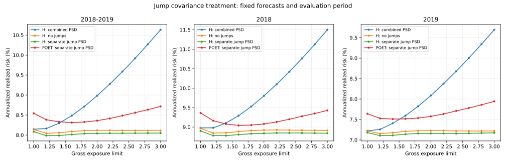

# High-Frequency Volatility Modeling

200개 종목의 1분 로그가격으로 공분산 행렬을 예측하고, 그 예측으로 구성한 포트폴리오의 위험을 평가한 프로젝트. POSTECH IME 연구실 인턴에서 다룬 FIVAR 연구를 바탕으로, 2026년 10월에 기존 코드와 평가 절차를 재점검.

## 분석 내용

- 사전평균화와 잡음 보정으로 일별 연속 공분산을 추정하고 점프 성분을 분리.
- 날짜별 공통 성분을 제거한 뒤, GICS 산업분류를 적용해 개별 성분을 구성.
- Huber 회귀와 L1 규제를 적용해 공통·개별 성분의 다음 날 값을 예측.
- 2018~2019년 497거래일에 대해 전날까지의 정보로 투자 비중을 정하고, 당일 10분 수익률로 실현 위험을 계산.
- 점프 행렬의 보정 순서에 따른 포트폴리오 위험과 투자 비중의 변화를 비교.

## 결과

2018~2019년, 총 익스포저 한도 3.0, 연 250거래일 기준.

| 모형과 점프 처리 | 연율화 위험 |
|---|---:|
| H-LASSO: 합산 후 PSD 보정 | 10.63% |
| H-LASSO: 점프 제외 | 8.11% |
| **H-LASSO: 점프를 먼저 PSD 보정** | **8.05%** |
| POET: 점프를 먼저 PSD 보정 | 8.72% |

같은 점프 보정 방식과 투자 제약에서 H-LASSO의 위험은 POET보다 약 **0.67%포인트, 상대적으로 7.6% 낮은 수준**. 해당 데이터와 평가 조건에서 관찰한 위험 차이로, 수익률 개선을 의미하는 결과는 아님.



점프 추정 행렬은 두 추정량의 차이로, 음수 고유값이 발생할 수 있는 구조. 이를 그대로 더한 뒤 전체 행렬을 보정하면 일부 방향의 추정 위험이 거의 0으로 감소. 점프 행렬부터 보정했을 때 기존 연속 공분산의 위험을 깎아 내리는 문제가 사라졌으며, 같은 H-LASSO 예측에서도 포트폴리오 위험이 10.63%에서 8.05%로 변화. 새 예측모형의 성능 향상이 아닌 **행렬 처리 방식에 대한 민감도 분석**.

## 실행

Python 3.11 이상 환경에서 다음 명령으로 실행.

```bash
pip install -r requirements.txt
python experiments/fivar_rolling_evaluation.py \
  --prices-csv data/log_price.csv \
  --gics-csv data/gicslist.csv \
  --workers 2
```

가격 CSV는 첫 열에 시각, 나머지 200개 열에 로그가격을 배치. GICS CSV는 헤더가 있는 한 열로 구성하고, 가격 열과 같은 종목 순서를 사용. 입력 파일은 비공개. 계산한 일별 행렬과 예측은 `cache/`에 저장.

예측 저장 후 포트폴리오 평가만 재실행 가능.

```bash
python experiments/fivar_rolling_evaluation.py --stage evaluate
python -m unittest discover -s tests
```

원자료 없이도 [결과 노트북](notebooks/research_workflow.ipynb), [위험 비교표](results/portfolio_risk.csv), [행렬 예측오차](results/matrix_prediction_errors.csv) 확인 가능.

## Reference

Shin, M., Kim, D., Wang, Y., & Fan, J. (2025).
*Factor and Idiosyncratic VAR Volatility Matrix Models for Heavy-Tailed High-Frequency Financial Observations.*

[arXiv:2109.05227](https://arxiv.org/abs/2109.05227)
